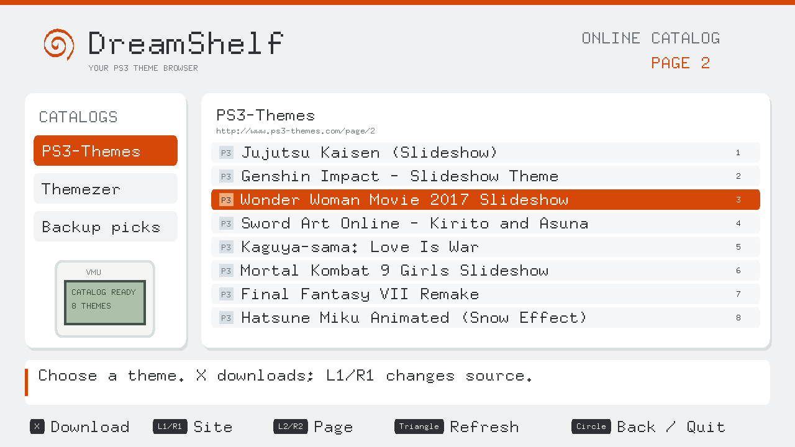

# DreamShelf

Download PS3 themes directly on your console, with a Dreamcast-inspired interface.

- Browse PS3-Themes, Themezer and a curated backup catalog.
- Continue through catalog pages with Down or L2/R2.
- Cache visited pages for 30 minutes for quicker return visits.
- Download P3T files to the HDD, then choose them in XMB Theme Settings.

*Code-rendered preview of the production UI; sample theme names.*

## Install

Download **DreamShelf-v0.1.4.pkg** from [Releases](https://github.com/richard1222/DreamShelf/releases), install it with Package Manager, then open **DreamShelf**. CFW or HEN is required to run the app.

Themes save to `/dev_hdd0/theme/`. Quit the app and select one through **Settings > Theme Settings > Theme**. DreamShelf does not apply themes automatically.

## Controls

| Button | Action |
| --- | --- |
| L1 / R1 | Change site |
| Up / Down | Select a theme; crossing the page boundary changes pages |
| L2 / R2 | Previous / next catalog page |
| Left / Right | Jump ten rows |
| X | Download selected theme |
| Triangle | Refresh current page |
| Circle | Cancel a transfer, or quit when idle |

## Catalogs

- [PS3-Themes](http://www.ps3-themes.com/)
- [Themezer](https://themezer.net/ps3/themes)
- [WhatWhatBoy curated backup](https://whatwhatboy.com/console/ps3/themes.html)

The curated backup has 28 entries. Larger catalogs load one page at a time. Site availability and ordering can change. Search and picture previews are not included yet. No theme files are bundled; original authors retain their rights.

HTTPS downloads verify certificates against the included Mozilla CA list from curl.se. The original PS3-Themes endpoint uses public HTTP. Downloads have size limits and cancellation, and completed files are preserved.

## Build

Use a [PSL1GHT](https://github.com/ps3dev/PSL1GHT) toolchain with SDL2, curl, mbedTLS and zlib [PS3 portlibs](https://github.com/ps3dev/ps3libraries). Set `PS3DEV` and `PSL1GHT` to your SDK prefix and add its `bin`, `ppu/bin` and `spu/bin` directories to PATH. Run `make pkg`.

The installable, finalized output is `build/DreamShelf-v0.1.4.pkg`. The `.debug.pkg` file is an intermediate. Application ID `THMS00001` preserves the existing ThemeShelf installation identity.

Host tests are in `tests/`. The catalog test accepts saved HTML fixtures as command-line arguments; those third-party pages are not bundled. Cache tests and the UI raster preview can run with a C++17 host compiler. Network timing and startup logs are written to `/dev_hdd0/tmp/themeshelf.log`; caches use `/dev_hdd0/tmp/themeshelf/`.

## License and credits

DreamShelf-owned code is **GPL-2.0-or-later**; see [LICENSE](LICENSE). Controller, font rendering and watchdog code derive from [Atari4PS3](https://github.com/richard1222/Atari4PS3). Font data retains its MIT/public-domain notices. See [third-party notices](THIRD_PARTY.md).

DreamShelf is independent homebrew and is not affiliated with Sega, Sony or the catalog sites.
